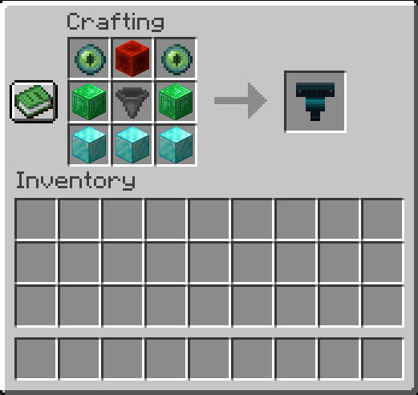
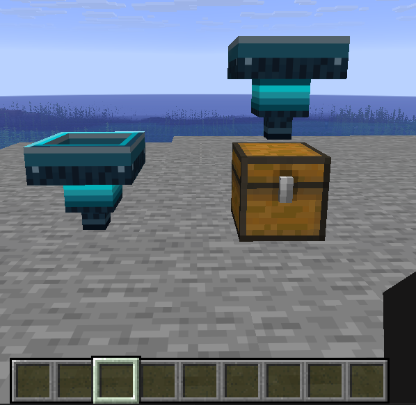
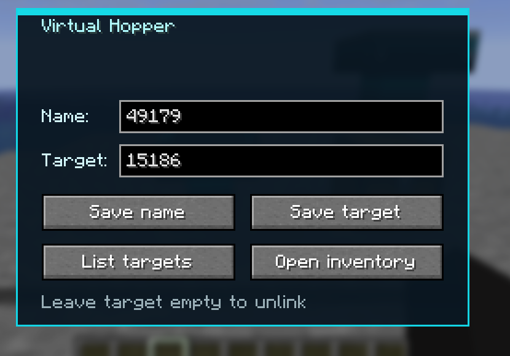

# Virtual Hopper

**Connect hoppers across distances, dimensions, and storage systems — without long chains of pipes.**

Virtual Hopper is a Fabric mod for **Minecraft Java Edition 26.3** that adds a new hopper block capable of automatically transporting items to another named Virtual Hopper. It keeps the familiar five-slot hopper inventory while adding a compact configuration screen, persistent destination links, and a distinctive dark-teal/cyan design.

**Author:** TueftelTyp  
**Current version:** 1.9.0  
**Mod ID:** `virtualhopper`  
**Platform:** Fabric  
**Languages:** English and German

<div style="display: flex; gap: 10px;">



</div>

## Features

- **Wireless item transfer:** Automatically send items from one Virtual Hopper to another named Virtual Hopper, even when they are far apart.
- **Cross-dimensional links:** Connect hoppers in different dimensions when enabled in the mod's configuration.
- **Automatic unique names:** Newly placed hoppers receive a random five-digit ID. Rename them at any time; names are reserved globally across a world and its dimensions.
- **Persistent settings:** Hopper names, destinations, and the stored destination location are saved with the world.
- **Familiar inventory:** Each Virtual Hopper provides five inventory slots and can collect dropped items and pull items from an inventory above it.
- **Normal hopper output:** If no remote destination is configured, the hopper can transfer items to a container in the direction it faces.
- **Safe transfer behavior:** If the destination is full, missing, or in an unloaded chunk, the items remain in the source hopper instead of disappearing.
- **Configurable crafting:** Change the nine recipe ingredients through the optional Mod Menu integration in singleplayer.
- **Custom appearance:** A vanilla-style hopper shape with a dark metallic look and cyan accents, plus its own mod icon.
- **Multilingual UI:** German and English translations.

## How to Use

1. Craft and place at least **two Virtual Hoppers**.
2. Each placed hopper automatically receives a unique five-digit name, such as `04721`.
3. Open a hopper's settings with **Shift + Right-click**, or use the settings entry in its inventory.
4. Optionally replace its ID with a memorable name, such as `Mine_Input` or `Main_Storage`.
5. In the sending hopper's **Target** field, enter the receiving hopper's exact name and save the target.
6. Put items into the sending hopper, or let it pull items from a container above it. The items will automatically move to the destination when the destination chunk is loaded and has room.

Use **Show targets** in the settings screen to find known destination names. To disconnect a hopper, clear its target field and save it.

> **Important:** Remote transport does not force-load distant chunks. The destination must be loaded for transfers to take place. Existing hoppers from older versions may need their target reassigned once after an update.

## Crafting Recipe

The default recipe is deliberately expensive to reflect the power of long-distance item transport:

| | | |
|:---:|:---:|:---:|
| Eye of Ender | Redstone Block | Eye of Ender |
| Emerald Block | Hopper | Emerald Block |
| Diamond Block | Diamond Block | Diamond Block |

**Total:** 2 Eyes of Ender, 1 Redstone Block, 2 Emerald Blocks, 1 Hopper, and 3 Diamond Blocks. Produces **1 Virtual Hopper**.

## Recipe Configuration (Mod Menu)

[Mod Menu](https://modrinth.com/mod/modmenu) is an **optional client-side mod** used to access the recipe editor:

1. Install the compatible Mod Menu version for Minecraft 26.3.
2. Open **Mods → Virtual Hopper → Configure**.
3. Edit the nine Minecraft item identifiers, for example `minecraft:diamond_block`.
4. Select **Save Recipe**.
5. Leave and reopen your singleplayer world to activate the updated recipe.

The editor writes a world-specific datapack to:

```text
saves/<world>/datapacks/virtualhopper_recipe/
```

The editor currently requires a valid item identifier in every slot; it does not provide a graphical item picker or empty recipe slots. For dedicated servers, the **server operator** must install or edit a recipe datapack on the server; clients cannot change server recipes through Mod Menu.

## Configuration

After the mod has been started, the general settings are stored in:

```text
config/virtualhopper.json
```

Available settings:

| Setting | Default | Description |
|---|---:|---|
| `transferIntervalTicks` | `8` | Number of game ticks between transfer attempts (clamped to 1–1200). |
| `allowCrossDimension` | `true` | Allows sending items between dimensions. |
| `collectDroppedItems` | `true` | Allows collection of dropped item entities above the hopper. |

These general settings are edited in the JSON file; the Mod Menu interface currently edits the **crafting recipe only**.

## Multiplayer and World Data

Virtual Hopper's transfer and naming logic runs on the server. Each name is reserved across the server's dimensions, including for hoppers whose chunks are not currently loaded. The name registry is stored in the world's `data/virtualhopper_names.json` file. Names are released when the corresponding hopper is broken normally.

When upgrading an existing world from an older mod version, **make a backup first**. Older hoppers are entered into the global name registry when their chunks load, so previously unloaded legacy hoppers may not be accounted for immediately during migration.

## Requirements

- Minecraft Java Edition **26.3**
- **Fabric Loader** and **Fabric API** compatible with Minecraft 26.3
- **Java 25**
- **Mod Menu** (optional, for the singleplayer recipe editor)

Install the built mod JAR and Fabric API into your Minecraft `mods` folder. Add Mod Menu if you want the in-game recipe editor.

## Building from Source

Use Java 25 and Gradle 9.8.2 (or the compatible Gradle version used by your development environment):

```bash
gradle --no-daemon clean build
```

The resulting mod JAR is placed in `build/libs/` after a successful build. Building requires access to Minecraft/Fabric and related Maven repositories.

## Notes

- A Virtual Hopper retains items when its remote target cannot accept them.
- Cross-dimensional transfer can be disabled in the configuration.
- The recipe editor does **not** instantly reload a running world.
- On dedicated servers, gameplay settings and recipes are controlled server-side.

## License

The source project includes a `LICENSE` file. Refer to that file for the applicable distribution terms.

---

**Virtual Hopper** — developed by **TueftelTyp**.
